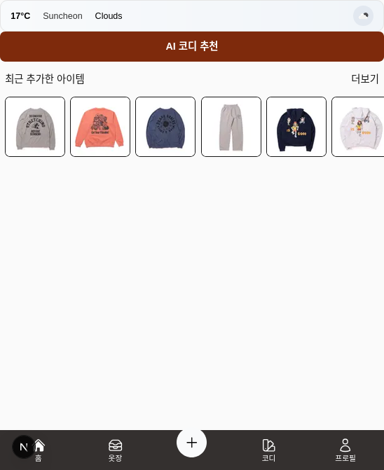

# AI연동 옷장 관리 앱

## Project Tech Stack

### Framework

- Next.js v16.3.0

### Language

- TypeScript v5

### UI

- Tailwind CSS v4앱
- React v19.2.8
- Heroicons v2.2.0

### Database

- SQLite via Prisma (v7.9.1)
- @prisma/adapter-better-sqlite3

### Authentication

- bcrypt v6.0.0
- iron-session v8.0.4

### Validation

- zod v4.4.3

## 주요 기능

### 최근 추가한 의류 아이템

- Home 탭에서 최근에 등록한 의류 아이템을 확인할 수 있습니다.

### 현재 위치와 날씨 정보 제공

- OpenWeatherMap API를 통해 제공되는 현재 위치의 날씨정보를 실시간 제공합니다.
  - Home탭 접근 시 마다 API fetch가 이루어짐
  - 이 기능은 일정시간 단위로 fetch하도록 수정 예정
- 실시간 날씨 정보를 바탕으로 AI 기반 의상 코디를 추천정합니다.

### 카테고리별 의류 확인 및 코디 추천

- 옷장 탭에서는 등록된 의상 아이템을 카테고리별로 확인할 수 있습니다.
- 각 아이템 클릭으로 상세 정보를 확인할 수 있습니다.
  - 각 아이템의 평가/TPO 등의 수정 발생 시 실시간 갱신 되지 않는 문제는 수정 예정
- 각 아이템 별로 AI 기반 의상 코디를 추천합니다.

### 향후 추가 기능

- 코디 탭을 통해 나만의 코디를 구성하고 저장할 수 있도록 구현할 예정입니다.
- 저장한 코디 정보를 활용해 AI 의상 추천 기능을 고도화할 예정입니다.
- 프로필 탭에 각자 구독중인 AI 서비스 API를 등록할 수 있도록 할 예정입니다.
